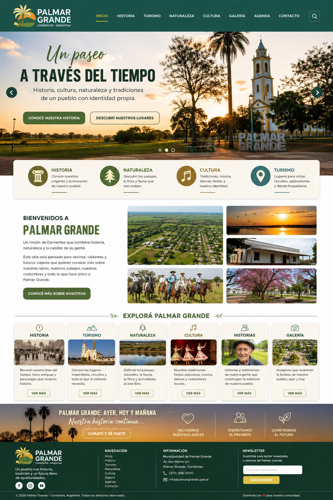
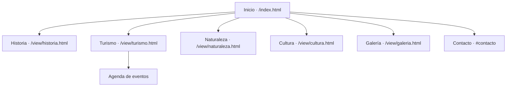

<div align="center">

# 🌿 Palmar Grande
### Un paseo a través del tiempo

**Sitio turístico y cultural de Palmar Grande · Corrientes, Argentina**

Explorá la historia, la naturaleza, la cultura y los lugares de la comunidad.



<br>

`HTML` · `CSS` · `JavaScript` · `Sitio estático`

</div>

> **Sobre la imagen:** es un mockup de referencia del diseño. Algunas secciones que aparecen allí pueden diferir de la versión implementada.

---

## ✨ El proyecto

Una página web informativa para presentar Palmar Grande y acercar su patrimonio a vecinos y visitantes. El sitio reúne contenido local, fotografías y accesos a las principales áreas de interés.

## 🧭 Mapa del sitio



| Sección | Ruta | Contenido |
| --- | --- | --- |
| **Inicio** | [`palmar-grande-web/index.html`](./palmar-grande-web/index.html) | Presentación, enlaces rápidos, reseña, mapa y formulario de contacto. |
| **Historia** | [`view/historia.html`](./palmar-grande-web/view/historia.html) | Reseña histórica y patrimonio local. |
| **Turismo** | [`view/turismo.html`](./palmar-grande-web/view/turismo.html) | Información turística y calendario de eventos. |
| **Naturaleza** | [`view/naturaleza.html`](./palmar-grande-web/view/naturaleza.html) | Biodiversidad, paisajes, flora y fauna. |
| **Cultura** | [`view/cultura.html`](./palmar-grande-web/view/cultura.html) | Fiestas, comidas típicas, ritos y costumbres. |
| **Galería** | [`view/galeria.html`](./palmar-grande-web/view/galeria.html) | Fotografías del pueblo en un collage adaptable. |
| **Contacto** | [`index.html#contacto`](./palmar-grande-web/index.html#contacto) | Formulario para compartir historias o consultas. |

> El enlace **Contacto** del menú principal actualmente lleva a la página de Turismo; el formulario de contacto está en la sección `#contacto` de Inicio.

## 🗂️ Estructura

```text

├── index.html              # Página de inicio
├── styles.css              # Estilos compartidos y diseño adaptable
├── script.js               # Menú móvil y respuestas de formularios demo
├── view/
│   ├── historia.html
│   ├── turismo.html
│   ├── naturaleza.html
│   ├── cultura.html
│   └── galeria.html
└── assets/
    ├── palmar-grande-mockup.png
    ├── videoMuestra.mp4
    └── imagenes/            # Fotografías, logo e iconos
```

## 🚀 Cómo verlo

No hace falta instalar dependencias ni compilar el proyecto.

1. Cloná o descargá este repositorio.
2. Abrí la carpeta `palmar-grande-web` con VS Code.
3. Iniciá un servidor estático desde esa carpeta, por ejemplo con la extensión **Live Server**; también podés ejecutar:

   ```bash
   py -m http.server 8000
   ```

4. Visitá [`http://localhost:8000`](http://localhost:8000).

## 🧰 Tecnologías y comportamiento

- **HTML, CSS y JavaScript nativos:** páginas estáticas, sin framework ni proceso de build.
- **Diseño adaptable:** navegación y contenido ajustados a pantallas grandes y móviles.
- **Interacciones:** menú móvil, galería con visor de imágenes y respuestas de demostración para los formularios.
- **Recursos externos:** tipografías de Google Fonts y mapa incrustado de Google Maps; necesitan conexión a internet.

## 📌 Estado actual

- El formulario de contacto muestra una confirmación en pantalla, pero **no envía ni guarda** el mensaje.
- El formulario de newsletter también es demostrativo y **no registra suscripciones**.
- Las páginas, estilos y recursos se sirven como archivos estáticos; no hay backend ni base de datos.
- El contenido turístico y la agenda pueden ampliarse con información validada por la comunidad.

---

<div align="center">

Hecho para compartir la historia y la identidad de **Palmar Grande** 💚

</div>
